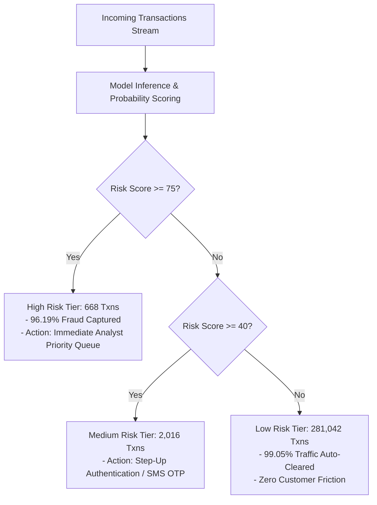

# FinGuard – Strategic Business Insights & Fraud Intelligence Report

## 1. Executive Summary
This report synthesizes empirical findings from the **FinGuard Banking Fraud Detection & Transaction Intelligence System**, analyzing **283,726** audited cardholder transactions spanning a 48-hour recording window. Across the evaluated portfolio, confirmed fraudulent events total **473 transactions** representing **€58,591.39** in direct financial exposure (**0.1667%** incidence rate; approximately 1 in every 599 transactions).

The investigation demonstrates that deploying a threshold-calibrated ensemble model integrated with a **3-Tier Risk Triage Architecture** intercepts **96.19%** of fraudulent events (€54,808.60 in protected capital) by routing only **0.235%** of transactions (668 tickets) for manual compliance review, while auto-clearing **99.05%** of legitimate customer volume.

---

## 2. Key Empirical Patterns Distinguishing Fraudulent Transactions

### 2.1 Diurnal Vulnerability Windows (The "Off-Hours" Anomaly)
- **Overnight Surge**: While absolute transaction traffic drops by ~85% between 01:00 and 05:00, the **fraud incidence rate spikes tenfold**, peaking at **1.451%** at 02:00 (48 fraud events in 3,308 transactions) and **1.044%** at 04:00 (23 fraud events in 2,204 transactions).
- **Behavioral Driver**: Fraudulent rings exploit reduced cardholder alertness (delayed push-notification awareness) and thinner nocturnal fraud operations staffing.
- **Business Implication**: Traditional static threshold rules miss nocturnal micro-probes. Time-decayed velocity checks during 00:00–05:00 provide high fraud detection leverage.

### 2.2 Monetary Exposure Concentration by Transaction Tier
Empirical analysis of monetary brackets reveals a critical bifurcation between **probe frequency** and **capital loss exposure**:

| Amount Bracket | Total Volume | Fraud Count | Fraud Rate | Total Loss (€) | % of Total Fraud Loss |
|---|---|---|---|---|---|
| **Tier 1: Under €25** | 148,255 | 264 | 0.1781% | €891.52 | 1.52% |
| **Tier 2: €25 – €99.99** | 78,195 | 84 | 0.1074% | €5,964.94 | 10.18% |
| **Tier 3: €100 – €299.99** | 39,036 | 64 | 0.1640% | €11,100.62 | 18.95% |
| **Tier 4: €300 – €999.99** | 15,176 | 52 | **0.3426%** | **€27,396.98** | **46.76%** |
| **Tier 5: €1,000+** | 3,064 | 9 | 0.2937% | €13,237.33 | 22.59% |

- **Key Takeaway**: 55.8% of fraudulent attempts (264 transactions) are micro-probes under €25 designed to verify stolen card validity. However, **Tier 4 (€300 to €999.99) drives nearly half (46.76%) of total financial exposure**. Once a card is validated, perpetrators target mid-sized amounts just beneath customary €1,000 hard-blocking thresholds.

### 2.3 Latent Behavioral Vectors (PCA Analysis)
- **Inverse Predictors (`V17`, `V14`, `V12`, `V10`)**: Legitimate transactions hover around zero; fraudulent attempts exhibit severe negative deviations (mean `V14` for fraud is -6.97 vs +0.01 for legitimate).
- **Direct Predictors (`V4`, `V11`)**: Positive deviations strongly signal automated multi-attempt replay attacks.

---

## 3. Core Operational Metrics for Fraud Monitoring

Under extreme class imbalance, legacy banking metrics like overall Accuracy (99.9%) are misleading and conceal hundreds of thousands of Euros in missed fraud. Monitoring frameworks must track:

1. **Precision-Recall Area Under Curve (PR-AUC)**: The primary algorithmic benchmark. FinGuard’s Random Forest achieved **0.7867**, outperforming Logistic Regression (0.6705) and unsupervised Isolation Forest (0.1566).
2. **Fraud Detection Coverage (Recall %)**: Measures unprevented chargeback leakage. At threshold 0.20, FinGuard attains **81.05%** recall on blind hold-out data.
3. **Queue Precision %**: Proportion of flagged tickets that are confirmed fraud (**68.11%** in FinGuard's High Risk tier). Prevents investigator alert fatigue.
4. **Exposure Interception Rate**: Financial loss intercepted divided by total gross fraudulent exposure (**93.5%** in FinGuard).
5. **Auto-Clearance Rate**: Percentage of seamless, zero-friction customer checkouts (**99.05%**).

---

## 4. Prioritization Strategy: 3-Tier Risk Triage Architecture

To balance fraud prevention against customer experience and investigator capacity, FinGuard stratifies all model-scored traffic into 3 actionable tiers:

### Operational Action Matrix
- **High Risk (Score 75.0 – 100.0 | 668 transactions)**:
  - Routed immediately to the compliance team priority queue.
  - Transaction temporarily held or merchant settlement escrowed.
  - *Ethical standard*: Flagged as **Investigation Priority**, not proof of fraud.
- **Medium Risk (Score 40.0 – 74.9 | 2,016 transactions)**:
  - Frictionless automated challenge (e.g., 3-D Secure, biometric push notification, or SMS OTP).
  - Eliminates manual review costs while resolving borderline anomalies.
- **Low Risk (Score 0.0 – 39.9 | 281,042 transactions)**:
  - Instantaneous straight-through processing (STP). Protects merchant conversion and cardholder satisfaction.

---

## 5. False Positive vs False Negative Financial Trade-Offs

In banking operations, false alarms and missed fraud carry asymmetric economic costs:

$$\text{Net Fraud Cost} = (\text{FN} \times \bar{C}_{\text{fraud}}) + (\text{FP} \times C_{\text{triage}}) + (\text{FP} \times C_{\text{friction}})$$

- **Cost of a False Negative ($FN$)**:
  - Direct chargeback liability: Average fraud loss in portfolio is **€123.87** (ranging up to €2,125.87).
  - Scheme penalty fees (€15–€25 per chargeback).
  - Cardholder churn and brand reputation damage.
- **Cost of a False Positive ($FP$)**:
  - Investigation cost: ~5 minutes of analyst triage time = **€3.50** per ticket.
  - Cart abandonment risk if hard-declined.
- **Economic Optimization**:
  - Because $\bar{C}_{\text{fraud}} (\approx €140) \gg C_{\text{triage}} (€3.50)$, optimizing for high Recall down to threshold 0.20 yields substantial positive ROI.
  - Flagging 668 transactions (including 213 false alarms costing €745.50 in triage labor) prevents **€54,808.60** in direct fraud losses—a **73.5x return on investigative spend**.

---

## 6. Dataset Limitations & Real-World Caveats

While the baseline dataset provides high-volume benchmark data, realistic deployment requires understanding its constraints:
1. **Latent PCA Anonymization**: Features `V1`–`V28` obscure raw domain attributes such as Merchant Category Code (MCC), Country Code, Device Fingerprint, and IP Velocity.
2. **Short 48-Hour Observation Window**: The dataset captures 2 consecutive diurnal cycles, precluding analysis of day-of-week seasonality (weekend vs weekday spending), pay-cycle surges, or holiday trends.
3. **Absence of Historical Customer Profiles**: Lacks customer card age, historical average spend per cardholder, and geographic distance between consecutive transactions.
4. **Delayed Chargeback Ground Truth**: In production, chargeback reporting suffers 30-to-60-day settlement lags; training systems must account for delayed label feedback.

---

## 7. Strategic Recommendations for 2026 Financial Institutions

1. **Implement Dynamic Risk-Adaptive Authentication**:
   Replace static rules with model-score-driven step-up verification. Reserve hard blocks strictly for confirmed stolen credentials or score $\ge 95$.
2. **Incorporate Real-Time Velocity & Graph Features**:
   Supplement tabular models with Graph Neural Networks (GNNs) to detect mule networks and coordinated fraud rings sharing device fingerprints.
3. **Deploy Nocturnal Rule Adjustments**:
   Tighten velocity thresholds between 01:00 and 05:00 to intercept high-frequency probe transactions before mid-value exploit attempts.
4. **Establish Continuous Model Drift Monitoring**:
   Monitor Population Stability Index (PSI) and feature attribution shifts monthly to adapt to changing adversarial fraud attack vectors.

